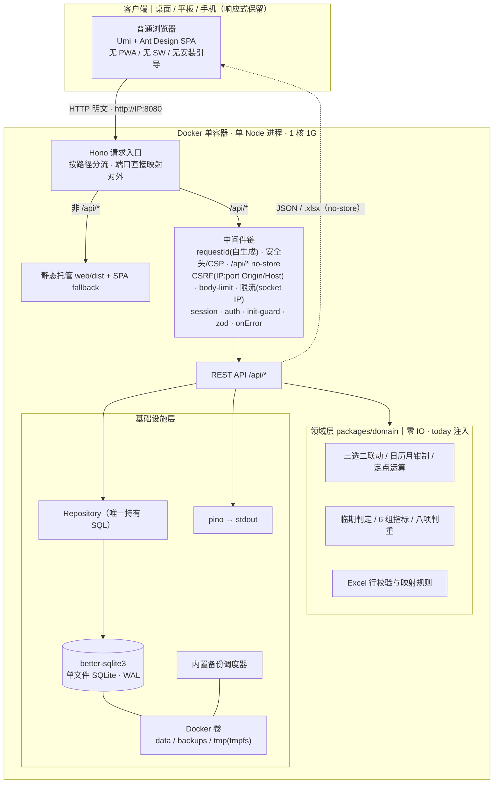
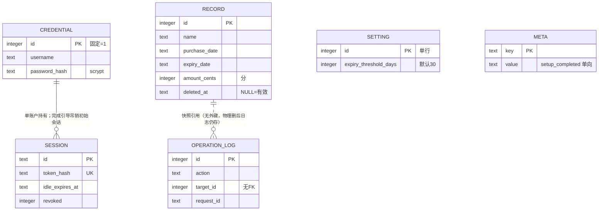

# 进货统计 Web 应用 · 项目交付方案

> **编制**：高屋建（首席交付架构师）· 全栈架构交付专家团
> **版本**：**v1.1（个人自用精简版）** ｜ **日期**：2026-11-05
> **交付形态**：**仅设计文档，不含实现代码**
> **团队产出**：许可研（场景产品）· 梁承宇（系统架构）· 储海量（数据建模）· 颜可心（前端体验）· 程不宕（后端服务）· 陆上线（部署运维）· 凌无缺（测试验收）
> **未调度成员**：智能体应用工程师 —— 本项目为确定性规则实现，明确不引入任何大模型/智能体能力

---

## 0. 文档说明与当前状态

### 0.1 v1.1 变更说明（由用户第四轮确认驱动）

v1.0 按「公网单实例 + 单账户 + PWA」设计。用户第四轮明确将项目收窄为**个体商家个人自用统计**，本版据此整体降级：

| # | 变更 | 用户依据 |
|---|------|---------|
| 1 | 按个人项目缩小范围，**企业级流程全砍** | 「按照个人项目缩小范围，企业级的一些流程是不需要的，进行精简」 |
| 2 | **业务功能 100% 保留**（10 字段、两组三选二联动、Excel 双向全套、编辑/删除/批量删除、操作日志、回收站、大屏 6 卡 + 临期过期预警、单账户账密登录） | 用户选择「只砍企业级流程」 |
| 3 | **PWA 取消**：manifest 可安装、SW 静态缓存、安装引导、离线相关设计整段删除；**响应式与手机端适配保留** | 「先不要 pwa 了」 |
| 4 | **部署收敛**：仅 Docker 单容器 + 账密验证；服务器无备案，走纯 HTTP + `IP:非标端口`；不要域名 / HTTPS / 独立 Nginx / Cloudflare | 「只用 docker 部署 + 账密验证即可」「服务器无备案」 |
| 5 | **告警只做应用内**（大屏临期/过期预警清单），无任何外部通道 | 「告警只做应用内告警」 |
| 6 | **无合规要求**，合规章节整章删除 | 「属于个体商家自用统计，无需合规等要求」 |
| 7 | 版本锁定 **Node 26.13.0 / pnpm 12.6.0** | 用户指定 |
| 8 | 服务器 **1 核 1G** | 「服务器为 1h1g」 |
| 9 | 文档原地升级 v1.0 → v1.1，附删减对照表 | 用户选择「原地升级为 v1.1」 |

**讨论过但被否决的部署形态**（详见 10.3）：Cloudflare Workers Static Assets + `/api/*` 同源反代、Cloudflare Named Tunnel、v1.0 的独立 Nginx + HTTPS 域名方案。原因：PWA 取消后 HTTPS 不再是硬要求，用户最终只要「Docker + 账密」。

### 0.2 文档口径

- 本版由 7 份专业分册的**差异清单**汇编，成员结论冲突处由主理人**显式裁决**，全部记录于第 10 章，不和稀泥。
- 标注 **【待确认】** 者为未拍板项，附录 A 汇总并给出建议默认值；不编造用户未说过的事实。
- v1.0 测试分册的「整体 No-Go」指**未来实现完成后的上线门禁状态**，不作用于设计文档交付；v1.1 已删除 Go/No-Go 门禁，该结论**不沿用、也不产生新的 Go/No-Go 判定**。
- 附录 B 保留上游风险编号原文（用于校正各分册推断映射），并按 v1.1 结论旁注关闭状态。

---

## 1. 一句话项目定义与成功标准

> **项目定义**：面向个体商家本人的进货流水账工具，以**普通 Web 浏览器**逐笔登记 10 个字段的进货明细，用统计大屏开屏即得累计经营指标与临期/过期风险，并支持 Excel 双向流转；部署为**单台 1 核 1G 服务器上的 Docker 单容器**，经 `http://IP:PORT` 纯 HTTP 访问，单账户账密登录。

**成功标准（个人自用口径，4 条，均可由本人直接验证）**：

| # | 标准 | 可度量口径 | 相对 v1.0 |
|---|------|-----------|-----------|
| 1 | 录入一条记录的耗时 | 打开录入页 → 保存成功，本人连续几次正常操作取中位数 **≤30 秒**；两组三选二自动带出后无需手工复算 | 保留目标值，删 P50/P95 统计门禁口径 |
| 2 | 大屏当天数据准确 | 打开首页无需二次筛选/刷新即呈现 6 组指标卡与临期/过期清单；以**当天**为基准日，与当天库内有效记录人工核对一致；新增/编辑/删除/恢复后再次打开即时反映 | 首屏 ≤2s 降为观察项，不再作为通过条件 |
| 3 | 导入导出无损 | 一次真实往返（导出 → 再导入）10 个业务字段逐字段一致率 **100%**；错误行「行号 + 原因」可唯一命中原文件对应行 | 保留 100% 正确性，删「≥1000 行 × 10 字段」压测规模 |
| 4 | 账密可自助初始化【新增】 | 首启控制台取得 `admin` + 随机初始密码 → 首次登录强制 `/setup` 设置正式账密 → 状态持久化、引导不可重入（重启容器 / 直达 `/setup` / 换浏览器均被拒）→ 用自设账密可登录；全程不依赖域名、证书、外部运维流程 | 对应用户「仅 Docker + 账密验证」 |

**4 个 100% 正确性要求全部保留**（引导页重入拦截率、错误行定位准确率、Excel 往返字段一致率、回收站恢复成功率）。v1.1 删除的是企业级**统计样本量与门禁机制**（≥30 次尝试 / ≥200 注入错误行 / 10000 格 / ≥100 条 DB diff），改为本人一次可执行的抽样核对 —— **删的是门禁规模，不是正确性**。

---

## 2. 需求范围

### 2.1 MVP 范围（Must 28 条，见附录 C 校正）

| Epic | Must 编号 | 范围摘要 | v1.1 |
|------|----------|---------|------|
| A 认证与初始化 | A1–A4 | 首启打印 `admin` + 随机初始密码；首次登录强制独立引导页设置正式账密；状态位单向、引导不可重入；登录失败限流 | 4 条全保留（A4 限流 IP 来源改直取 socket） |
| B 逐笔录入与联动 | B1–B7 | 10 字段全部可手填；日期组与金额组三选二；保质期 天/月/年 + 日历月回退；自动值可手填覆盖且不重算；进货日期默认当天；最小校验集 | 7 条全保留 |
| C 记录维护 | C1–C5 | 编辑/删除、批量删除（二次确认）、回收站（恢复+彻底删除）、操作日志、条件筛选 | 5 条全保留 |
| D 统计大屏 | D1–D3 | 6 组指标卡、临期/过期预警清单、单一可配阈值 X（默认 30 天） | 3 条全保留；D2 即「应用内告警」载体 |
| E Excel 双向 | E1–E6 | 模板下载、逐行校验与错误行报告、八项判重、按筛选/日期范围导出、往返不丢字段、整批原子 | 6 条全保留 |
| F **端适配** | F1 | 电脑端 / 手机端等常见屏幕响应式 | **F2（PWA 可安装+SW）、F3（断网提示）删除；组名去掉 PWA** |
| G 持久化与会话 | G1–G2 | 容器重启/重建账本不丢且可恢复、会话与密码安全基线 | 2 条保留（口径改写，功能不变） |

> **取消 PWA ≠ 取消移动端**：取消的是「桌面图标 / SW 缓存 / 离线外壳」，入口从桌面图标变成浏览器地址栏；F1 仍是 Must，手机浏览器经 `IP:PORT` 必须能完成**全部**业务功能。

### 2.2 后续迭代（本期不做）

- **Should**：预警分级着色（D4）、本月/本周指标卡（D5）。
- **Could**：历史商品名联想、批量编辑、操作日志导出、更多筛选维度、回收站自动清空、预警「已处理」标记、跳过错误行继续导入。
- **v1.1 新增「后续可选」三项**（触发前不得顺手实现）：

| 项 | 触发条件 | 说明 |
|---|---------|------|
| PWA（manifest + SW + 安装引导） | 用户明确希望「手机桌面一键打开」时 | 须重新定义业务数据联网边界；**离线录入/同步仍为 Won't，不随 PWA 回归** |
| HTTPS（TLS + 证书 + `Secure` Cookie + HSTS） | 服务器完成备案并接入固定域名后 | 届时首要风险「明文传输」自动缓解 |
| 自定义域名（含 CDN / WAF / 反向代理） | 备案完成 + 有固定域名 + 用户愿承担运维 | 当前既定形态为纯 HTTP + `IP:PORT` |

- **演进触发条件**（改写）：累计 >50 万行或大屏明显变慢 → 加汇总表；单次导入需求 >1000 行 → 先评估上调上限与引入 `worker_thread`。原「>5000 行」阈值随上限下调失效。

### 2.3 明确不做（Won't）

| 被裁项 | 原因 |
|--------|------|
| PWA 可安装（manifest）与 SW 静态资源缓存 | 用户明确取消 PWA，浏览器直接访问即可 |
| 离线只读 / 离线录入 / 离线同步 / 断网态提示 | 本期**连静态缓存都不做**，无离线态；普通 Web 断网即无法访问 |
| HTTPS / 域名 / 公网安全网关（Nginx、HSTS、WAF、fail2ban） | 无备案服务器走纯 HTTP + `IP:PORT`，不引入企业级网关 |
| Cloudflare Workers Static Assets / Named Tunnel 前后端分离 | 单容器单进程已满足，徒增外部依赖与运维面 |
| 外部告警通道（webhook、本机邮件转发、宿主 cron 轮询、`wall`、运维状态卡） | 告警只做应用内大屏预警清单 |
| 合规审计（合规风险章节、记录保存期限、数据分级、合规导出格式适配） | 用户确认无合规要求 |
| CI/CD 与异地副本（发布流水线、门禁、制品追溯、第二块盘、异地 rsync、季度演练） | 企业级交付流程全砍，1 核 1G 单盘 |
| 企业级门禁（SLA、并发压测指标、Go/No-Go、人工签字放行、缺陷分级时限、多角色协作） | 个人自用，无值班、无对外可用性承诺 |
| 多账户 / 权限隔离 / 水平扩展 | 单账户单实例无隔离诉求 |
| 趋势图、排行图、图表下钻、重型图表库 | 目标仅「累计 + 风险」；也降低包体积 |
| 供应商字段 / 在库记录数 / 库存概念 | 字段集锁定为 10 项；系统只有进货流水、无出库数据 |
| 任何大模型 / 智能体能力 | 全部需求为确定性规则，**能用规则解决的不上模型** |

### 2.4 关键业务规则速查（BR-1 ~ BR-11，v1.0 原样保留）

| 规则 | 结论 |
|------|------|
| 联动状态机 | 字段来源三态 `EMPTY / AUTO / MANUAL`；引擎**永不写 MANUAL 槽**、每组至多 1 个 AUTO、AUTO 不可作锚点；覆盖后锁定不重算 |
| 数值精度 | 单价 4 位 / 数量 3 位 / 金额 2 位（分），整数定点 + HALF_UP，禁止浮点累加；除零不执行、不产生 NaN/Infinity |
| 日期三选二 | 到期日 = 生产日期 + N（**不减 1**）；月/年按日历回退并钳制到目标月最后一日；钳制不可逆可接受，靠手填优先兜底；不允许到期日早于生产日期 |
| 临期语义 | 剩余天数 = 到期日 − 服务器本地自然日；`0 ≤ d ≤ X` 为临期（含等号），`d < 0` 为已过期；阈值单一可配，着色仅展示层 |
| 指标卡口径 | 6 组：累计进货金额 / 累计笔数 / 商品种类数（按 `name_norm` 归一化去重）/ 累计数量 / 临期笔数与金额 / 过期笔数与金额；统一排除软删；到期日为空不计入风险项 |
| 判重口径 | 八项全等 = 商品名 + 进货日期 + 生产日期 + 到期日期 + 规格 + 单价 + 数量 + 金额；**备注与保质期不参与、回收站不参与**；归一化后比较；命中整批拦截并报告 |
| 展示格式 | 全站 `YYYY-MM-DD`；金额展示千分位 + 2 位（展示态带 ¥、录入态不带）；保质期「数值 + 单位」 |
| 回收站与日志 | 删除一律软删进回收站；恢复保留原字段与来源标记；彻底删除二次确认且不可恢复；日志 append-only、与业务写同事务 |
| Excel 原子性 | 整批全有或全无；错误行不落库；报告行号 = Excel 物理行号（模板第 1 行为表头） |
| 导出范围 | 当前筛选 ∩ 日期范围内的有效记录；仅 10 个业务字段，不含内部 ID、不含回收站；表头文案与列序由 `EXCEL_HEADERS` 单一真源保证 |

---

## 3. 系统架构与技术选型

### 3.1 架构总览

> **单容器、单进程、单账户、纯 HTTP**：普通浏览器经 `http://<IP>:<非标端口>` 直连唯一一个 Hono 进程，该进程同时托管 Umi 构建产物与 `/api/*`，全部业务规则由框架无关的纯函数层实现，数据落在 Docker 卷持久化的单文件 SQLite。**无边缘层、无 SW、无外部服务、无异步中间件、无图表与 AI 依赖。**



### 3.2 分层与依赖方向（硬约束）

| 层 | 职责 | 允许依赖 |
|----|------|---------|
| 客户端层 | 表单录入与即时联动、大屏渲染、Excel 上传下载、三档响应式 | → 应用层；构建期复用领域层源码 |
| 应用层 | 静态托管与 SPA fallback、安全/CSP/缓存头、鉴权/限流/CSRF/错误中间件、路由编排、请求级事务边界 | → 领域层、基础设施层 |
| 领域层 | 全部业务规则纯函数 | 仅 `packages/shared` 的类型与常量；**零 IO、零框架、零 `Date.now()`** |
| 基础设施层 | Repository（唯一持有 SQL）、DB 连接与 PRAGMA、卷、日志、备份调度 | 无反向依赖 |

> v1.0 的 5 层收敛为 **4 层**：删除「边缘层（Nginx）」整层，客户端直连应用层。原本由边缘层承担的 TLS、安全头、体积/超时限制、可信头覆写全部**迁移到 Hono 应用层**，能力保留但归属改变。

禁止：`domain → apps/*`、`shared → domain`、`apps/web ↔ apps/server` 直接源码引用；SQL 只允许出现在 Repository；`better-sqlite3` 等原生模块禁止进入 `domain` / `shared` / 前端 bundle。

### 3.3 pnpm monorepo 包划分

```
stockin/
├── pnpm-workspace.yaml          # apps/* 与 packages/*
├── package.json                 # 根：pnpm -r 脚本编排、engines.node / packageManager 锁版本
├── tsconfig.base.json / .node-version
├── apps/
│   ├── web/                     # Umi 4 前端（React + Ant Design 5，无 PWA 资源）
│   └── server/                  # Hono 服务（API + 静态托管 + DB + 备份调度 + CLI）
├── packages/
│   ├── shared/                  # DTO / 枚举 / 错误码 / zod schema / EXCEL_HEADERS
│   └── domain/                  # 纯函数：联动 / 日历 / 定点 / 临期 / 判重 / 聚合口径 / Excel 规则
├── docker/  ·  docs/
```

- **只设 4 个包**：1 人全栈，多拆一层只增加构建与版本同步成本。
- **核心价值**：联动、临期判定、Excel 行校验规则放在 `domain`，前端打包复用做即时联动，服务端复用做导入补算与保存校验 —— **一份实现、两处运行**。
- **开发期**：`pnpm -r dev`，Umi proxy 把 `/api` 代理到 `127.0.0.1:3000` 保持同源（避免 HttpOnly Cookie 写不进去）。
- **生产期**：Hono 单进程统一托管 `web/dist` + SPA fallback，单镜像内前后端产物同版本。

### 3.4 技术选型表（含被否决备选）

| 领域 | 选定 | 选择理由 | 被否决备选及理由 |
|------|------|---------|-----------------|
| 运行时 | **Node 26.13.0 / pnpm 12.6.0** | 用户锁定；`.node-version` 与 `engines.node` 写全版本、`packageManager` 锚定 pnpm、三阶段同 digest、启动自检断言版本 | `pnpm@12` / `26` 浮动版本（原生 addon ABI 与锁文件格式敏感）；依赖宿主机全局 pnpm 或 Corepack 联网拉最新版（构建不可复现）；Volta/nvm/asdf（容器内不需要多版本切换）；仅用 `engines`（默认只警告不阻断） |
| 服务端框架 | **Hono**（`@hono/node-server`） | TS 优先、Web 标准 API、内置中间件与 `serveStatic`，一个进程同时托管静态资源与 REST | Express（中间件需自行拼装）；NestJS（DI/Module 对单账户 CRUD 过重） |
| 前端工程 | **Umi 4**（React 18） | 约定式路由、开箱构建链与 proxy、与 Ant Design 同生态 | 裸 Vite + React（需自建约定）；Next.js（SSR 收益为零且需第二进程） |
| 数据库/驱动 | **SQLite + better-sqlite3** | 单文件零独立进程、同步事务 API 让整批导入极简、WAL 下在线备份成熟 | PostgreSQL/MySQL（运维量翻倍）；`node:sqlite`（实验性）；`sqlite3` 异步驱动（批量事务啰嗦） |
| 仓库形态 | **pnpm workspace monorepo** | 前后端共享 DTO 与联动纯函数，契约变更一次提交对齐 | 前后端多仓库（版本错配）；npm/yarn workspaces（幽灵依赖控制弱）；单包混放（原生模块易进前端 bundle） |
| UI 组件库 | **Ant Design 5** | 密集表单/表格/上传/日期场景开箱即用 | shadcn/ui + Tailwind（需自组装）；Element Plus（Vue 生态）；纯手写 CSS（成本高） |
| 大屏呈现 | **Statistic/Card/Table + CSS Grid 纯 DOM** | 需求只有指标卡 + 清单，零图表依赖、静态资源体积最小 | ECharts / AntV / Recharts（引入即纯增体积）；DataV（与三端响应式定位不符） |
| Excel 解析生成 | **exceljs（仅服务端）** | 流式读写、模板可写日期格式与数据校验下拉、便于按行号定位错误 | SheetJS 社区版（写样式受限、历史 CVE）；前端解析（阻塞主线程且服务端仍需二次校验） |
| 校验 | **Zod**（schema 放 `shared`） | 一份 schema 同时驱动表单、API、Excel 三处校验 | Joi（浏览器体积/TS 推导弱）；Yup（交叉字段表达力弱）；手写 if（无法产出结构化错误行） |
| 会话 | **服务端会话表 + HttpOnly Cookie**（`HttpOnly; SameSite=Lax; Secure=false`） | 可服务端即时吊销；**纯 HTTP 下 `Secure` 会使浏览器不回传 Cookie，登录态直接失效** | JWT（无法主动失效）；无状态签名 Cookie（吊销困难）；`Secure=true`（本期不可用）；`__Host-` 前缀（强制要求 `Secure`，纯 HTTP 不可用） |
| 密码哈希 | **Node 内置 `crypto.scrypt`**（N=2^15, r=8, p=1, keylen=64, salt 16B） | 免新增原生编译依赖；参数落库可升级 | bcrypt（72 字节截断 + 额外原生模块）；argon2（跨架构构建成本不抵收益）；MD5/SHA（公网等同失守） |
| 日志 | **pino → stdout** | 结构化、低开销、requestId 可贯穿 | winston（transports 过重）；裸 `console.log`（无级别无结构） |
| 迁移 | **自研 `NNN_*.sql` + `PRAGMA user_version`** | SQLite 单文件最轻，升级可复现 | Prisma Migrate / Drizzle Kit（与原生 SQL + Repository 冲突）；手工改库（不可复现） |
| 备份 | **`db.backup()` 在线快照** | WAL 下仍是一致性快照，无需停服 | 直接 `cp` db 文件（WAL 未合并时不一致）；独立 cron 容器（违背单进程） |
| 任务编排 | **根 `pnpm -r` 递归脚本** | 4 个包，足够 | Turborepo / Nx / Lerna（对 4 包小仓过度设计） |
| 静态缓存 | **标准 HTTP 缓存头**（Hono 下发） | 无 SW 后由 HTTP 头承担，成本为零 | Cache Storage / Cache-First / SW 版本化（PWA 已取消） |
| 边缘层 | **无（Hono 直连公网）** | 单容器单进程，1 核 1G 不再跑第二进程 | Nginx（需域名/证书/常驻进程）；Caddy / Traefik；Cloudflare Workers / Tunnel（外部依赖） |

### 3.5 接口契约摘要（v1.0 原样保留，业务端点一条不删）

统一前缀 `/api`，JSON 请求/响应；Excel 端点例外（multipart / 二进制流）。

| 分组 | 主要端点 |
|------|---------|
| 认证与初始化 | `GET /api/health`、`GET /api/auth/init-status`、`POST /api/auth/{login,logout,setup}`、`GET /api/auth/me` |
| 进货记录 | `GET/POST /api/records`、`GET/PUT/DELETE /api/records/:id`、`POST /api/records/batch-delete` |
| 回收站与日志 | `GET /api/trash`、`POST /api/trash/:id/restore`、`DELETE /api/trash/:id`（物理删）、`GET /api/operation-logs` |
| 统计大屏 | `GET /api/dashboard`（一次往返含 6 组指标 + 预警清单 + 阈值 + 基准日）、`GET /api/stats/{summary,expiry}` |
| Excel | `GET /api/excel/template`、`POST /api/excel/import`、`POST /api/excel/export` |
| 设置与备份 | `GET/PUT /api/settings`、`POST /api/backup`、`GET /api/backups`（**仅元数据，无下载**） |

- **错误信封**：`{ code, message, details?, requestId }`；`requestId` 由 **Hono 自生成**（忽略入站同名头），贯穿 pino 日志与操作日志表。
- **错误码分段**：`AUTH_*` / `VALID_*` / `RECORD_*` / `EXCEL_*` / `COMMON_*`；HTTP 严格限定 400/401/403/404/409/413/422/429/500/503。
- **前端统一动作**：401 跳登录、403 `AUTH_INIT_REQUIRED` 跳引导、429 读 `Retry-After`、422 渲染字段错误或错误行报告、5xx 展示 `requestId`；**写操作绝不自动重试**。
- **init guard 白名单**：仅 `health / init-status / login / logout / me / setup`；`init_state=0` 时其余业务接口一律 403。
- **删除**：`manifest.webmanifest` / `sw.js` 静态路由、`Service-Worker-Allowed` 类响应头、`/healthz` 别名（只保留 `GET /api/health`，少一个未鉴权入口）。

### 3.6 非功能性设计（按个人项目重写）

| 维度 | 目标与手段 |
|------|-----------|
| 性能 | 【假设：单账户并发≈1、1 核 1G】**不设 P95 SLA**，以本人实际可用为准。手段保留：单遍 `SUM/COUNT` 条件聚合、到期日区间索引扫描（WHERE 中不对列做函数运算）、prepared statement 复用、导入单事务批量写、路由级代码分割。导入上限 **2MB / 1000 行 / 15s deadline** |
| 安全 | **账密验证 + 会话 + 登录限流 + 上传校验 + 首要风险明示入表**。具体：CSP `default-src 'self'` + `style-src 'self' 'unsafe-inline'`（AntD CSS-in-JS 所需）由 **Hono 唯一发起点**下发；`nosniff` / `X-Frame-Options: DENY` / `Referrer-Policy: no-referrer`；Cookie `HttpOnly; SameSite=Lax; Secure=false`；CSRF 按 `http://<IP>:<PORT>` 字面量做 Origin/Host 精确比对（含端口）、不信任任何 `X-Forwarded-*`；限流取 socket `remoteAddress`；登录失败 5 次/15 分钟双维度；xlsx 魔数/大小/行数/解压字节/sheet 数/禁公式/临时文件即删；备份无公网下载端点。**不引 TLS/WAF/fail2ban/网关** |
| 可靠性 | WAL + `synchronous=NORMAL` + `busy_timeout=5000`；启动自检（integrity_check / user_version / 卷可写 / 磁盘余量）失败 fail-fast；`db.backup()` 每日 + 导入前 + 迁移前 + 手动 + 凭证重置前；优雅停机（等重任务 → checkpoint → close）。**不承诺在线率，异常手工重启即可** |
| 同步边界 | **全部同步**，无队列/SSE/WebSocket；重任务信号量(1) + 15s deadline + 每 500 行 `setImmediate` 让出事件循环；健康检查走内存 readiness，重导入期间仍可应答 |
| 资源 | 前端**必须离线构建**后打进镜像，禁止生产机构建；容器内唯一 Node 进程、不跑任何 sidecar；`--max-old-space-size=512` / `--memory=768m` / tmpfs 32MB；静态资源默认从镜像内磁盘读取、不预热进内存 |
| 告警 | **只保留大屏临期/过期预警清单**（业务功能），删除全部系统运维告警通道与运维状态卡 |
| 成本 | 【假设：复用已有 1 核 1G 服务器、无域名、无证书、无云组件、1 人全栈不计人力、无按量计费项】增量基础设施成本 ≈ 0 |

---

## 4. 数据库设计摘要（**业务功能 100% 保留，数据层零改动**）

### 4.1 概念模型



`records` 是**进货事实表**，不是库存状态表。无出库单、无结存、无批次扣减；临期/过期是随基准日变化的**派生展示属性**，不落库为状态列；回收站不是独立表，是 `deleted_at IS NOT NULL` 的子集视图。

### 4.2 表清单（6 张，全部不变）

| 表 | 关键字段 | 设计要点 |
|----|---------|---------|
| `records` | 10 业务字段（保质期拆 `shelf_life_value` + `shelf_life_unit`）、`name_norm`/`spec_norm`、**6 个 `*_src` 来源位**、`deleted_at`、`created_at`/`updated_at` | 来源位 6 个 INTEGER（0=USER 1=AUTO），与「值是否为空」组合表达 API 三态；`amount_cents NOT NULL DEFAULT 0` |
| `settings` | `id=1`（CHECK 单行）、`expiry_threshold_days`（默认 30，范围 0~3650） | 单行强类型表，否决 key-value |
| `sessions` | `token_hash` UNIQUE、空闲 7 天 / 绝对 30 天双过期、`revoked` + `revoked_reason`、`account_id` FK | DB 绝不存明文 token；有效判定不做 SQL 日期函数运算；**`Secure=false` 不改变表结构** |
| `operation_logs` | `action`、`target_type`、`target_id`（**无外键**）、`detail`(JSON)、`request_id`、`actor` | append-only、不自动清空、不软删；物理删后审计链不断 |
| `meta` | `setup_completed`（单向 0→1）、`schema_version`、`last_backup_*`、`baseline` 相关键 | **触发器硬保护** 1→非1 与 DELETE，引导不可重入的唯一权威 |
| `credentials` | `id=1`、`username`、`password_hash` + `salt` + `scrypt_params`、`is_initial` | 独立单行表；初始密码明文绝不入库 |

### 4.3 存储口径（全部不变）

| 项 | 结论 | 被否决备选 |
|----|------|-----------|
| 金额/单价/数量 | 整数定点：金额分 10²、单价 10⁴、数量 10³；`SUM` 全整数零误差；判重天然归一化 | `REAL`（浮点误差，明令禁止）；`DECIMAL/TEXT`（无法精确 SUM） |
| 业务日期 | `YYYY-MM-DD` TEXT，字典序 = 时间序，裸列区间比较直接命中 B-tree | 整数 epoch day（可读性差） |
| 审计时间戳 | UTC ISO 8601 文本；SQL 内禁用 `date('now')` / `CURRENT_DATE`，基准日由应用层注入 | DB `DEFAULT CURRENT_TIMESTAMP`（UTC 与容器本地日不一致） |
| 保质期 | 拆「数值 + 单位」两列，成对 CHECK；导出时合并为单列文本 `"12个月"` | 单列自由文本（无法计算） |
| 备注/规格/商品名 | 原样存储用于展示导出；另写归一化列用于判重与种类数去重 | SQLite 生成列（归一化规则升级需回填） |
| 判重 | 普通部分索引探测 + 应用层报告 + 整批回滚 | **数据库 UNIQUE 约束**（无法区分批内/库内、无法定位行号） |

### 4.4 索引（8 条，均为裸列 + 常量比较，全部不变）

| 索引 | 支撑查询 |
|------|---------|
| `idx_records_active_purchase_date`（部分索引 `WHERE deleted_at IS NULL`） | 进货日期范围列表/导出/分页排序 |
| `idx_records_active_expiry_date`（含 `amount_cents` 覆盖） | 临期/过期区间扫描与金额聚合 |
| `idx_records_active_name_norm` | 商品名前缀筛选、`COUNT(DISTINCT name_norm)` |
| `idx_records_active_dedup`（**普通**索引，8 列） | 八项判重探测；可空列用 `IS` 做 NULL 安全等值 |
| `idx_records_trash_deleted_at` | 回收站列表 / 恢复 / 彻底删除 |
| `idx_oplogs_occurred_action`、`idx_oplogs_target` | 日志时间范围与类型、按记录追溯 |
| `idx_sessions_token_hash`（UNIQUE）、`idx_sessions_active_expiry` | 会话校验与过期清理 |

**铁律**：Repository 每条查询必须显式写 `deleted_at IS NULL`；「变化的一侧」全部在应用层算成常量边界，SQL 内不对列做函数运算。

### 4.5 迁移、备份与数据治理

- **迁移（不变）**：`NNN_*.sql` 三位递增、已发布脚本不可改；`PRAGMA user_version` 为唯一权威版本，启动比对 `SCHEMA_EXPECTED`；迁移前自动快照、单脚本单事务、失败即非零退出；本期只用 `ADD COLUMN`（带 DEFAULT）+ `ADD INDEX`。
- **备份（降级）**：`db.backup()` 在线一致性快照；触发 = 每日 / 导入前 / 迁移前 / 手动 / 凭证重置前（**保留**，属数据安全兜底）；校验链 `integrity_check` → `user_version` → 魔数 → sha256 → gzip → `gzip -t` → 入池（**保留**）；**保留策略改为「最近 7 份」**（按份数，超出删最旧），剩余空间不足则跳过本次并在应用内提示；GC 前断言至少保留 1 份 `integrity=ok` 快照。
- **删除**：9GB 规划基准、`/srv/stockin` 独立分区 ≥20GB、每月 1 份归档、硬上限 30 份、异地副本、季度恢复演练、RPO/RTO 表、合规留存期、数据分级、磁盘 <10%/<200MB 外部告警。
- **保留的正确性修复（不属企业级流程）**：① 快照元数据记 `init_state` + 引导完成后立即生成 `baseline` 基线快照 + 恢复选片优先「`init_state=1` 且 `user_version` 兼容」；② `user_version` 等值自检 + 显式 CLI `schema:allow-rollback` 放行 + fix-forward 优先；③ 破坏性迁移登记「不可回滚下限」。
- **事务（不变）**：业务写 + 操作日志同事务，日志写失败即整批回滚；`setup` 的凭据更新 + 状态位 + 吊销全部会话 + 日志四者同一事务；`operation_logs` append-only 机制保留（删除的只是「合规留存期」指标）。
- **1 核 1G 数据侧约束**：PRAGMA 三项维持原值不调优；单次导入**整批单事务边界绝不拆分**（拆事务会破坏「全有或全无」Must），只调分片与上限；备份与导入互斥的全局信号量(1) 保留。

---

## 5. 前后端与智能体实现要点

### 5.1 领域纯函数层（前后端共用单一真源，不变）

`packages/domain` 零 IO、零框架、零 `Date.now()`，`today` 由调用方注入。对外函数面：`applyFieldEvent`（联动状态机 reducer）、`computeDateGroup` / `computeAmountGroup`、`addShelfLife` / `diffShelfLife`（日历月钳制、闰年）、`fixedMul/fixedDiv/fixedRound`、`normalizeForCompare`（八项判重键）、`expiryWindow` / `classifyExpiry`、`aggregateRules`（6 组指标口径）、`excelRules`（表头、物理行号、issue 结构）。

**三选二状态机不变量**：① 引擎永不写 MANUAL 槽；② 每组至多 1 个 AUTO；③ AUTO 不可作推导锚点；④ 全同步纯函数，无异步竞态。数值输入用 `raw/parsed` 双态，避免 `0.` 等中间态误判除零。

### 5.2 服务端要点

- **中间件链顺序固定**：`requestId`（**Hono 自生成**）→ 安全头/CSP → CSRF（`Origin`/`Referer`/`Host` 按 `http://<IP>:<PORT>` 字面量精确比对，含端口）→ `body-limit`（2MB）→ `rate-limit`（取 socket `remoteAddress`，**忽略一切 `X-Forwarded-For`**）→ `session` → `auth guard` → `init guard` → `zod` → `handler` → 静态 fallback → `onError` → access log。
  > **删 Nginx 后不只是少一层**：无反代做可信头覆写，继续信任客户端头等于放行伪造；`Host` 精确比对顺带缓解 DNS rebinding（攻击者域名解析到该 IP 时 Host ≠ 字面 IP，直接 403）。
- **静态托管**：Hono `serveStatic` 直出 `apps/web/dist`；`/api/*` 优先匹配，未匹配返回 JSON 404 且**绝不** fallback 到 `index.html`；非 `/api` 的 GET 命中静态文件直出、未命中回 `index.html`（**SPA fallback 不因取消 PWA 而取消**，否则 `/records/:id/edit` 刷新即 404）。缓存头分级：`index.html` `no-cache`（配 ETag/Last-Modified）；带 hash 资源 `public, max-age=31536000, immutable`（`immutable` 仅作增强）；`/api/*` 与全部下载响应 `Cache-Control: no-store`。不启用运行时 gzip/br 压缩（1 核 CPU）。
- **认证状态机（不变）**：`init_state` 0→1 CAS（与 `user_version` 分字段/分表）；`auth_epoch` 递增吊销全部会话；登录后轮换 session id；完成引导不签发新会话，须用正式账密重登；重复 setup 一律 409；卷保留的容器重启**不重新生成、不重新打印初始密码**。会话 `Cookie` 改 `HttpOnly; SameSite=Lax; Secure=false`，`COOKIE_SECURE_MODE` 本期固定 false；会话 7 天/30 天双过期不变。
- **服务端不重算用户提交值**：API 只做「合法性 + 一致性」校验（金额允许 ≤1 分舍入容差），不补算、不改写；唯一例外是 Excel 导入时单元格确实为空的字段，复用 `domain` 同一份纯函数补算。
- **来源标记落库（不变）**：DB 6 个 INTEGER 列 ↔ API 三态由 Repository 映射；仅覆盖 6 个联动槽位，不含进货日期。
- **统计（不变）**：`/api/dashboard` 一个读事务快照内完成 —— 取一次 `today` → 读阈值 X → 单遍条件聚合 6 组指标 → 到期日区间索引扫描取分页清单。
- **Excel（上限调整）**：上传校验链（信号量 → 大小 ≤2MB → 临时文件 → 魔数/容器结构 → 解压后字节 ≤20MB / sheet / 单元格 / 行数 ≤1000 → 禁公式 → 表头一致性 → **15s deadline** → 导入前备份）→ 逐行 Zod + domain 校验 → 文件内 Map 自比 + 库内批量判重 → 存在任何 issue 则**不开启写事务**直接 422 报告 → 全部通过才 `BEGIN IMMEDIATE` 单事务批量写 + 1 条汇总日志 + COMMIT；异常全量 ROLLBACK。导出用 `StreamingWorkbookWriter` 逐行 commit 并**直接 pipe 到 Hono 响应流**，Repository 游标迭代逐行取数、禁止 `all()` / `writeBuffer()` 整文件缓冲。
- **幂等与并发（不变）**：`Idempotency-Key`（24h 快照）+ 状态位幂等 + `version` CAS；`SQLITE_BUSY` → `COMMON_BUSY(503)`；重任务信号量(1)，并发第 2 个导入返回 503 而非排队。**注意**：若幂等键由前端生成，须用 `crypto.getRandomValues()` 而非 `crypto.randomUUID()`（后者在纯 HTTP 非安全上下文不可用）。
- **可观测性（降级）**：pino JSON → stdout（容器不写日志文件）+ `redact` 脱敏 Cookie/密码/备注全文；`requestId` 贯穿响应头/错误体/日志/操作日志表。删除外部指标上报、APM、告警阈值体系、滑动窗口计数、设置页运维状态卡。登录失败每次写一条 append-only `operation_logs` + stdout WARN（**保留**，v1.0 裁决 10）。`/api/health` 纯内存 readiness、**不跑 SQL**，由三态简化为两态（`ok` 200 / `not-ready` 503），重导入期间仍可应答。

### 5.3 前端要点

- **路由（不变）**：`/` 大屏、`/login`、`/setup`（`layout:false` 独立）、`/records/new`、`/records/:id/edit`、`/records`、`/settings`、`/trash`、`/logs`；Excel 导入/导出/模板下载挂 `/records` 工具条，以 Drawer/Modal 承载。
- **AuthGuard 唯一真源（不变）**：初始化状态只信 `/api/auth/init-status`，绝不用 localStorage/sessionStorage 判定。
- **组件体系**：删除 `NetworkRequiredBanner`、`SwUpdatePrompt`、`InstallAppButton`；其余原子/分子/组织组件不变。
- **状态管理（不变）**：`useModel`（session / recordFilters / ui / importReport）+ `useRequest` + 统一 `request` 拦截层。
- **响应式（保留）**：手机 <768 / 平板 768–1199 / 桌面 ≥1200；表格降级卡片式列表 + 底部 BatchActionBar；表单单栏 + 分组 Collapse + 底部固定提交条；触控 ≥44×44px、颜色 + 文字双通道可达性实现保留，删除「WCAG 2.1 AA 合规」措辞（用户无合规要求）。
- **大屏（保留）**：6 组指标卡 CSS Grid + 预警清单（服务端排定，前端不二次排序）；开屏一次 `GET /api/dashboard`；不引图表库。删除「断网显示需联网」半句。
- **纯 HTTP 非安全上下文降级**（`http://<非回环 IP>:<PORT>` 下 `window.isSecureContext === false`）：
  - `navigator.clipboard` 为 `undefined` → `requestId` 一键复制 / 错误行复制改为「Clipboard API → `document.execCommand('copy')` + 临时 textarea → 选中文本提示手动 Ctrl+C」三级降级，**能力保留**。
  - `crypto.randomUUID()` 不可用 → 幂等键改用 `crypto.getRandomValues()`（非安全上下文仍可用），不改服务端契约、不新增端点。
  - 其余能力（fetch / `upload.onprogress` / Blob / `createObjectURL` / `<a download>` / localStorage / CSS Grid / AntD CSS-in-JS / `Intl.NumberFormat`）逐条核过，纯 HTTP 下**均不触及**。
  - 不依赖任何需安全上下文的 API；不引 Push / Notification / Geolocation / WebAuthn / IndexedDB / Web Worker。
- **接口对接**：前端 `credentials: 'same-origin'` **无需改动**（`Secure` 是 `Set-Cookie` 响应头属性，同源判定只看 scheme+host+port）；CSRF 无自定义 token 头，前端**无需新增/修改任何请求头**；业务请求显式带 `cache: 'no-store'` 作中间件漏配兜底；导出仍走 `fetch` → `response.blob()` → `createObjectURL` → `<a download>` → `revokeObjectURL`（`POST` 不能用裸 `<a href>`）。
- **无 SW 后的行为差异**：发版**无版本提示、无自动 reload**，用户刷新页面即取新 `index.html` → 引用新 hash 资源；长会话中已加载的旧 chunk 不会自动切换，新增「chunk 加载失败 → 提示刷新页面」通用兜底；断网直接浏览器网络错误 / `ErrorView`，**无任何可离线打开的静态壳**。
- **构建**：`apps/web/dist/` = `index.html` + content-hash `assets/*`；**不再产出** `manifest.webmanifest` / `sw.js` / `icons`；`index.html` 删除 `<link rel="manifest">` 与 `theme-color` meta。产物必须**离线构建后打进镜像**（禁止生产机构建），镜像内路径 `web/dist`；`pnpm 12.6.0` 仅构建期需要，runtime 镜像不带。产物门禁保留「原生 addon 不进前端 bundle」，删除「零外部 CDN / 零密钥扫描」独立门禁（CSP `'self'` 已天然保证）。

### 5.4 智能体能力：明确不引入

复核确认：**本项目不存在适合交给智能体的环节** —— 联动计算、日历回退、金额聚合、临期判定、Excel 校验判重、认证状态机全部规则确定、需可复现可审计。无向量库、无 Embedding、无 Prompt 策略、无评测集、无 token 成本、无 AI 专项测试。

---

## 6. 里程碑与排期

### 6.1 假设前提

- **1 人全栈**、无固定上线日期、以相对周（W）计；每周按 5 个工作日。
- 不含需求细化、视觉设计、外部协调、验收签字与部署流水线改造。
- 需求/契约在 M0 冻结；**28 条 Must 与 8 类边界专项不裁剪**。
- 复用已有 1 核 1G 服务器；无域名、无证书、无采购与备案时间。
- 相对周数为策略侧粗估，非承诺排期。

### 6.2 里程碑表（★ = 关键路径）

| # | 里程碑 | 相对周 | 交付物 | 依赖 | 关键路径 |
|---|--------|-------|--------|------|---------|
| M0 ★ | 需求与契约冻结 | W1 | 28 条 Must 定稿、`packages/shared` 与 `packages/domain` 接口定稿；**Node 26.13.0 / pnpm 12.6.0 构建链与 better-sqlite3 addon 冒烟** | — | ★ 阻塞全部 |
| M1 ★ | 骨架与认证 | W1–W2 | 4 包 monorepo、Dockerfile 三阶段、6 张表 + 迁移、认证与首次引导状态机、health、Hono 静态托管与 SPA fallback | M0 | ★ 阻塞所有业务页 |
| M2 ★ | 录入与联动 | W2–W3 | domain 纯函数实现、前端三选二状态机、records CRUD、来源标记持久化 | M1 | ★ 阻塞大屏与 Excel |
| M3 | 大屏与记录维护 | W3–W4 | 6 组指标卡、预警清单、阈值设置、软删/回收站/操作日志/批量删除 | M2 | 与 M4 共享 domain |
| M4 ★ | Excel 双向流转 | W4–W5 | 模板、逐行校验与错误行报告、八项判重、整批原子、按筛选导出、往返一致 | M2 | ★ 边界最密集 |
| M5 | **端适配** | W5–W6 | 三档响应式、表格降级卡片、触控可达性、纯 HTTP 非安全上下文降级（剪贴板 / 幂等键） | M3 | — |
| M6 ★ | 自用上线 | W6 | Vitest + 冒烟集 + 一页检查单、本地打镜像与传输、首次部署 6 步、首启引导与日志清理、baseline 快照 | M4 + M5 | ★ 收尾 |

**关键路径**：`M0 → M1 → M2 → M4 → M6`。相对 v1.0 的变化：M5 去掉 PWA/manifest/SW/断网态/Lighthouse，M6 去掉 CI/CD 门禁、10 万行压测、安全扫描、恢复演练。

---

## 7. 部署上线方案

### 7.1 部署拓扑与镜像

- **单容器单进程**：浏览器 `http://<IP>:<非标端口>` → Hono 唯一 Node 进程（静态托管 `web/dist` + `/api/*` + 内置备份调度器）。**无 Nginx、无 TLS、无 sidecar**；容器端口直接对外映射 `-p 0.0.0.0:<PORT>:<PORT>`，宿主防火墙/安全组仅放行该端口与 SSH。
- **默认端口 `8080`**【待确认：可改用 ≥10000 高端口降低扫描噪声】；`PUBLIC_ORIGIN=http://<服务器IP>:<PORT>`。
- **多阶段 Dockerfile（保留但精简）**：`deps`（`pnpm --frozen-lockfile`、装 `build-essential`/`python3` 源码编译 better-sqlite3）→ `build`（`pnpm -r build`，拓扑序 shared→domain→server→web，产出 `web/dist` 与 `server/dist`）→ `runtime`（`pnpm deploy --prod` 仅生产依赖 + 编译好的 `.node`、非 root、tzdata、HEALTHCHECK、`exec` 启动自检）。工具链留在 deps/build、**不进 runtime**。
- **三阶段引用同一精确 digest 的 `node:26.13.0-bookworm-slim`**【待确认：官方是否发布该精确 tag；若无，用 26 主线 slim + 启动版本断言】；`.node-version` = `26.13.0`、`engines.node` = `26.13.0`、`packageManager` = `pnpm@12.6.0`；启动自检断言 `process.versions.node`；构建末尾跑一行 `node -e "require('better-sqlite3')"` 冒烟。否决 alpine（musl 与 prebuild 不通用）、distroless、多架构 qemu。
- **风险（非结论）**：Node 26 新主版本可能无 better-sqlite3 预编译二进制 → 必须构建阶段源码编译；Umi 4 依赖链在 Node 26 下兼容性、Corepack 是否随附发行版，均需在搭骨架时实测，不预设结论。
- **单条 `docker run` 示意**（compose 同参数、可选）：

```
docker run -d --name stockin --restart unless-stopped \
  -p 0.0.0.0:8080:8080 \
  -e NODE_ENV=production -e TZ=Asia/Shanghai -e PORT=8080 \
  -e PUBLIC_ORIGIN=http://<IP>:8080 -e COOKIE_SECURE=false \
  -e NODE_OPTIONS=--max-old-space-size=512 \
  -v /srv/stockin/data:/app/data -v /srv/stockin/backups:/app/backups \
  --tmpfs /app/tmp:rw,noexec,nosuid,size=32m \
  --memory=768m --stop-timeout 40 \
  stockin:local
```

> 镜像经 `docker save | ssh docker load` 传入，**服务器只 load + run，绝不构建**。

### 7.2 卷与资源

| 目录 | 方式 | 说明 |
|------|------|------|
| `/app/data` | bind mount → `/srv/stockin/data` | 恢复需直接替换 db、清 `-wal/-shm`；命名卷路径隐蔽，1 人排障易错 |
| `/app/backups` | bind mount → `/srv/stockin/backups` | **不得在静态托管根内**；不要求独立分区/第二块盘 |
| `/app/tmp` | tmpfs **32MB**（`noexec,nosuid,mode=1700`） | xlsx 临时文件不落盘、容器销毁即清；v1.0 的 64MB 按 1 核 1G 下调 |

- 宿主目录 `0700` 且属主 UID 与容器 `USER` 一致（首次部署须显式 `install -d -o 10001 -g 10001 -m 0700 /srv/stockin/{data,backups}`，否则 Docker 以 root 自动创建导致启动自检 fail-fast）。
- 1 核 1G 资源约束：`--max-old-space-size=512` / `--memory=768m`【待确认按 exceljs 实测峰值调整】；禁止生产机构建；单进程不跑 sidecar；备份压缩包与 `.partial` 即清；Docker 日志轮转 `max-size 10m × 3`。
- `restart: unless-stopped` + 优雅停机（SIGTERM → readiness=false → 等在途导入 → 停调度器 → `wal_checkpoint(TRUNCATE)` → `db.close()`）+ `stop-timeout 40`；启动自检失败写 `.selfcheck_failed` sentinel 后退出，避免无限重启风暴。

### 7.3 发布方式（替换 v1.0 的 CI/CD 章）

- **本地构建 → 打镜像 → `docker save | ssh docker load` → 服务器一条 `docker run`**。无镜像仓库、无 CI 流水线、无 release manifest、无 tag 三件套、无人工审批卡点、无 30 分钟观察窗口。
- **回退**退化为「保留上一版镜像重新 run」这一条操作；不设蓝绿/滚动/金丝雀、不设回滚触发表。
- **保留的正确性约束**（不属企业级流程）：`SCHEMA_EXPECTED` 启动比对、`user_version` 等值自检 + 显式 CLI `schema:allow-rollback` 放行 + fix-forward 优先、两阶段迁移（兼容发布 → 清理发布）与破坏性迁移的「不可回滚下限」登记。
- **删除**：`pnpm audit` 门禁、产物外链/零密钥扫描门禁、镜像体积软阈值、arch tag、制品追溯、蓝绿发布、`--mount=type=cache` / BuildKit 远程缓存。

### 7.4 首次部署手册（一页 6 步）

1. **本地**：`pnpm -r build` 产出 `web/dist` 与 `server/dist`（建议统一放进 Dockerfile `build` 阶段，规避本机与镜像 Node 版本不一致）。
2. **本地**：`docker build -t stockin:local .`，构建末尾跑一行 `node -e "require('better-sqlite3')"` 冒烟（替代已删除的 CI 门禁）。
3. **传输**：`docker save stockin:local | ssh <host> docker load`（或等价离线拷贝），服务器不构建。
4. **服务器**：`install -d -o 10001 -g 10001 -m 0700 /srv/stockin/{data,backups}` → 执行 7.1 的 `docker run`。
5. **首启**：`docker logs stockin` 读取 `[BOOTSTRAP] admin + 随机初始密码` → 浏览器访问 `http://<IP>:<PORT>` → 首次登录 → `/setup` 设置正式账密 → 新账密重登。
6. **收尾**：引导成功后清理首启日志（`force-recreate` + 清空旧 LogPath + `grep` 核验无残留）并自动生成 `baseline` 基线快照。**验证不可重入**：重启容器 / 换浏览器 / 直达 `/setup` 三者均被拒，旧 Cookie 401。

**忘记凭证**：只走本机 CLI `node dist/cli/reset-credentials.js`（先做重置前快照）→ 生成新正式密码打印 → `auth_epoch` 递增吊销全部会话 → `init_state` 保持 1、引导页仍不可重入。**无 HTTP 改密端点、无修改密码页**。

**恢复陷阱（重要）**：若选中快照早于引导完成（`init_state=0`），恢复后会要求引导但初始密码已清 → 死锁。解法：元数据记 `init_state` + 引导后立即生成 `baseline` 基线快照 + 选片优先「`init_state=1` 且 `user_version` 兼容」。

### 7.5 备份与恢复

- 触发：每日 / 导入前 / 迁移前 / 手动 / 凭证重置前；全部受全局信号量(1)约束，与导入互斥。
- 校验链：`integrity_check=ok` → `user_version` 比对 → 魔数 → sha256 → gzip → `gzip -t` → 入池 → GC（GC 前断言至少留 1 份 `integrity=ok`）。
- **保留策略**：只保留**最近 7 份**（按份数，超出删最旧）；备份前检查剩余空间，不足则跳过本次并**在应用内提示**清理【待确认阈值：建议 200MB 或 10% 取先到者】；备份失败仅记 stdout 日志并在备份列表标失败态。
- **删除**：RPO/RTO 四场景表、SLA 数值、季度恢复演练、大版本前演练、恢复演练报告、异地副本、9GB 规划与 ≥20GB 分区。
- **明确保留事实**：单盘全损（data 与 backups 同盘、无异地）→ **全量数据丢失，不可恢复**，已作为已知前提写入风险表，不再提出异地方案。

### 7.6 可观测性（压到三项）

1. **pino JSON → stdout**（容器不写日志文件），Docker 日志轮转 `max-size 10m × 3`，`redact` 脱敏 Cookie/密码/备注全文。
2. **`GET /api/health`** 两态内存 readiness（`ok` / `not-ready` 503），不跑 SQL、重导入期仍可应答。
3. **应用内预警** = `/api/dashboard` 与大屏返回的临期/过期清单（含 `remainingDays`、`status`、阈值 X、基准日）。

**删除**：全部外部告警通道（宿主 cron 轮询、本机邮件/`wall`、Prometheus/Alertmanager/uptime 探测、webhook）、9 条运维告警阈值、滑动窗口计数、`health=degraded` 分级与 reason 回显、设置页运维状态卡、`/healthz` 别名。

---

## 8. 测试与验收清单

### 8.1 测试策略（1 人全栈最小可执行配比）

v1.0 的四层金字塔降级为**三件套**：

| 层 | 范围 | 工具 | 配比 / 时间 |
|----|------|------|------------|
| 单元 | domain 纯函数 6 类：联动状态机 / 日历月钳制 / 定点 HALF_UP 与除零 / 临期判定 / 八项判重 / 6 组指标聚合 | **Vitest** + fake timers | ≈70%，全量 ≤1 分钟 |
| E2E | 关键旅程冒烟（单浏览器 + 三档视口） | **Playwright** | ≈25%，≤5 分钟 |
| 手工 | 一页检查单 | 本人勾选 | ≈5%，≈15 分钟 |

- 合计 ≤20 分钟，每次提交前本地执行 + 手工勾选即可，**不设 CI 门禁**。
- **不单列 L2 集成层**：事务 / 状态机 / 日志类行为统一由 Playwright 冒烟集端到端 + 手工检查单承载，不新增套件层级。
- **工具被否决备选**：Jest（ESM/TS 配置重）、`node:test`（断言链弱）、Mock DB（验不了 SQL 语义与索引命中）、Supertest 起端口（慢）、**Cypress（纯 HTTP 单浏览器冒烟场景下无额外收益、工具链更重）**、JMeter、Burp Suite、人工 DevTools 读数。
  > v1.0 否决 Cypress 的理由是「SW/离线观测弱，而 Bx.8 是核心边界」；Bx.8 已随 PWA 删除，**理由改写但 Playwright 选型不变**。
- **环境**：不建常驻 QA 环境；本地 `:memory:` / 一次性容器（同镜像同 TZ）/ 线上仅健康检查。删除 10 万行种子与多环境矩阵。

### 8.2 用例与边界专项

| 项目 | v1.0 | v1.1 | 推导 |
|------|------|------|------|
| 功能用例 | 60 条（30 Must × 1 正 1 反） | **56 条**（28 × 2） | 删 F2、F3 各 1 正 1 反 |
| 边界专项 | 9 类 / 80 条 | **8 类 / 72 条** | 删 Bx.8「PWA 不缓存业务数据」整类（8 条） |
| 冒烟集 | 15 条（S-01~S-15） | **15 条**（净持平） | 删 S-12（SW/断网观测），槽位替换为纯 HTTP 会话断言；S-14 内容降级为导入上限冒烟，条数不变 |
| 非功能工具 | k6 / Lighthouse / axe-core / ZAP 共 4 套 | **0**（并入冒烟集 + 检查单） | 企业级流程全砍 |
| 发布门禁 | G-01~G-12 + 4 个 100% 硬指标 | **一页检查单** | 删统计口径与门禁机制 |

- **边界专项 8 类**：Bx.1 精度除零、Bx.2 跨月闰年、Bx.3 手填覆盖、Bx.4 Excel 错误行与整批原子、Bx.5 判重、Bx.6 引导不可重入、Bx.7 批量删除与回收站、Bx.9 开屏即得。
- **删除的测试范围及理由**：PWA 可安装性 / SW 缓存与更新 / 离线行为（测试对象已不存在）；Lighthouse（PWA 审计对象消失，且不设首屏自动化门槛）；axe-core（改手工走查 + 视口/DOM 尺寸断言，响应式本身保留）；OWASP ZAP baseline（**无合规要求 + 企业级流程全砍**，不是「无 CSP 可扫」——CSP 仍由 Hono 下发）；k6 与 P95（1 核 1G 单账户自用，替换为导入上限冒烟）；安全合规验收项；缺陷分级 P0~P3 与正式回归流程（改「发现即修 + 重跑冒烟集」）；Go/No-Go 门禁与 4 个 100% 硬指标的**统计口径**（对应业务行为验证一条不删）。

### 8.3 核心用例承载层映射（10 类，一条不删）

| # | 核心用例 | 承载层 |
|---|---------|--------|
| 1 | 两组三选二联动 + 来源标记持久化 | Vitest `applyFieldEvent` / `computeDateGroup` / `computeAmountGroup` + 冒烟 S-03、S-06 |
| 2 | 定点数 HALF_UP、除零不执行 | Vitest `fixedMul` / `fixedDiv` / `fixedRound` + S-04（3.3333×3=10.00） |
| 3 | 月/年钳制、闰年、不可逆不静默改写 | Vitest `addShelfLife` / `diffShelfLife` + S-05 |
| 4 | 八项判重（备注与保质期不参与、归一化） | Vitest `normalizeForCompare` + S-09 |
| 5 | 整批原子导入 | 冒烟 S-07（5 行含 1 错 → 0 落库）+ 检查单 1 次 1000 行往返 |
| 6 | 按筛选 / 日期范围导出 | 冒烟 S-08 + 检查单 |
| 7 | 软删回收站（恢复字段一致、彻底删二次确认） | 冒烟 S-11 |
| 8 | 日志 append-only、与业务写同事务 | 检查单：1 次删除后核 `/logs` 追加、无编辑/删除入口、写失败时业务写回滚 |
| 9 | 首次引导状态机（0→1、不可重入、吊销初始会话） | 冒烟 S-01、S-02 |
| 10 | 6 组指标卡 + 临期/过期口径（含等号） | Vitest `aggregateRules` / `classifyExpiry` / `expiryWindow` + S-10 |

### 8.4 一页手工检查单（替代 Go/No-Go）

**上线前**：`SCHEMA_EXPECTED` 与镜像内版本一致、Node 26.13.0 / pnpm 12.6.0 与镜像 digest 一致、`better-sqlite3` addon 可加载、宿主目录权限与卷可写、发布前快照完整校验链、备份路径不可公网下载、可回退镜像仍在本地、**明文传输知情确认签字项**。

**上线中**：单容器映射 `IP:非标端口`（非 80/443）、无域名无 Nginx；启动自检四项通过；health 可用；`/api/*` 与下载响应 `no-store`、Hono 下发 CSP 且放行 `style-src 'unsafe-inline'`；冒烟 15 条；首启引导后清理日志并 grep 核验。

**上线后**：首次备份 `integrity=ok`、容器重建不丢数据、6 组指标卡与当天库内记录人工核对一致。

**纯 HTTP 专项断言**（并入冒烟集）：① `Set-Cookie` 含 `HttpOnly` / `SameSite=Lax`、**不含 `Secure`**，登录后 Cookie 被保存并随后续 `/api/*` 回传（200 而非 401）；② `Origin`/`Host` 为 `http://<IP>:<port>` 的写请求放行，伪造 Origin/Host（其他 IP、其他端口、域名形式）被拒（403/401 且无写落库）；③ 1 核 1G 下跑 1 次 **1000 行上限内导入** + 1 次超限文件（>2MB 或 >1000 行）确认「明确报错且 0 落库」+ 期间 `/api/health` 可应答。

**明文传输知情确认**：单列 1 项检查单签字项 ——「账密与金额在纯 HTTP 下明文传输、`IP:PORT` 公网暴露已由使用者知情并接受」，签字 + 日期，随检查单留存；**属检查单签字项，非自动化测试**。

> 4 个 100% 正确性要求改以「每项 1 次可观测抽验 + 已知限制记录 + 签字」验证；**不沿用 v1.0 的 No-Go 结论，也不产生新的 Go/No-Go 判定**。

---

## 9. 风险清单与应对

### 9.1 首要风险（用户知情接受，v1.1 新增并置顶）

| 风险 | 描述 | 影响 | 已做的轻量缓解 | 明确不引入 |
|------|------|------|---------------|-----------|
| **R-1 账密与金额明文传输** | 纯 HTTP 上登录 POST、Cookie `sid`、10 字段（含金额）、`.xlsx` 全量可被链路嗅探或中间人读取/篡改 | **高** | scrypt 只保落库、`HttpOnly` + `SameSite=Lax`、Origin/Host 精确比对、`no-store`、登录后轮换 sid、日志 `redact` 脱敏、初始密码一次性 | TLS / 自签证书 / HTTPS 301 / WAF / CDN / VPN / 二次验证 / 任何企业级网关 |
| **R-2 `IP:PORT` 公网暴露** | 非标端口仍可被全网扫描；登录爆破面、xlsx 解析面、备份路径探测暴露 | **高** | 登录失败 5 次/15min 双维度限流、body/魔数/解压/公式校验链、备份无下载端点且不在静态托管根、统一 401 文案、可选 ≥10000 高端口降低扫描噪声 | WAF / HA / fail2ban / HSTS / 隐藏源站 |

> 与「无合规要求」严格区分：合规是**没有要求**，R-1/R-2 是**有风险但用户知情接受**。二者不可混为一谈。建议仅在可信网络使用、避免在公共 WiFi 录入敏感信息。

### 9.2 技术风险

| 风险 | 概率 | 影响 | 应对 |
|------|------|------|------|
| `better-sqlite3` 同步 API 阻塞事件循环，重导入期间服务短暂无响应 | 中 | 中 | 单次上限 2MB/1000 行 + 15s deadline + 信号量(1) + 每 500 行 `setImmediate`；health 走内存 readiness |
| SQLite 单文件与备份同盘，宿主机磁盘/整机故障**全量数据丢失** | 中低 | **高** | 明确「单盘全损不可恢复」为前提；保留最近 7 份快照；不再提异地方案 |
| 首次随机密码残留在 Docker 日志 | 中 | **高** | 引导后吊销初始会话 + `force-recreate` + truncate LogPath + grep 核验（检查单**必勾项**，纯 HTTP 下由建议提升为必做） |
| native addon 与 Node 26 ABI 强绑定，无预编译二进制 / 构建失败 | 中 | 高 | 三阶段同 digest、构建阶段源码编译并冒烟、启动版本断言；工具链不进 runtime |
| Umi 4 依赖链 / Corepack 在 Node 26 下兼容性未知 | 中 | 中 | 搭骨架时实测；不预设结论【待确认】 |
| 前后端共用 domain，误把原生模块打进前端 bundle | 中 | 中 | 严守依赖方向；产物门禁保留「addon 不进前端 bundle」 |
| 备份快照早于引导完成 → 恢复后进引导但初始密码已清（死锁） | 中 | **高** | 元数据记 `init_state` + `baseline` 基线快照 + 选片优先 `init_state=1`（v1.0 裁决 20，保留） |
| `user_version` 等值自检挡住镜像回退 | 中 | 高 | 显式 CLI `schema:allow-rollback` + fix-forward 优先（v1.0 裁决 21，保留） |
| 优雅关闭超时被 SIGKILL → WAL 未 checkpoint / 导入半批 | 中 | 中 | `stop-timeout 40` + readiness=false + 等信号量 + `exec` |
| 无 SW 后发版，旧页面懒加载 chunk 404 | 中 | 低 | 前端加「chunk 加载失败 → 提示刷新页面」通用兜底 |
| 移动网络下非标端口不可达 | 低 | 中 | 部署前用手机实测【待确认】 |
| 同名异写使「商品种类数」失真 | 中 | 中 | `name_norm` 归一化去重（与判重共用同一函数） |

### 9.3 进度与成本风险（压缩为一表）

| 风险 | 概率 | 影响 | 应对 |
|------|------|------|------|
| 联动/日历/精度口径未定即开工，导致 B/E/D 三组返工 | 高 | 高 | M0 冻结 28 条 Must 与 domain 纯函数接口；v1.0 第 10 章 11 项高阻塞裁决继续有效 |
| 范围蔓延（PWA / HTTPS / 趋势图 / 多账户 / AI 被顺手加回） | 中 | 中 | 2.3 Won't 清单锁死；后续可选三项须触发条件满足才立需求 |
| 1 人全栈，测试资产建设时间被开发挤压 | 高 | 高 | 优先锁定 Vitest 领域纯函数；冒烟集 ≤5 分钟；检查单一页 |
| Excel 导入边界最密集导致 M4 拖期 | 中 | 高 | M4 前先定判重键与原子性口径；复用 shared 单一 schema；**整批事务不拆** |
| 容量与资源参数为粗估，1 核 1G 实测可能偏离 | 中 | 中 | 全部标注假设前提与【待确认】；搭骨架时用实测校准（内存 / tmpfs / 导入峰值） |

> v1.0 的**合规风险整章删除**（用户裁决无合规要求）；成本风险按「复用已有服务器、无域名/证书/云组件、增量成本 ≈ 0」重写，不再保留 9GB/20GB 容量与报价表。

---

## 10. 决策与权衡

> 裁决依据优先级：**用户四轮明确选择 > 主理人默认假设（未经用户确认者不覆盖前者）> 成员建议**。成员结论冲突时显式裁决并记录，不折中、不含糊。

### 10.1 v1.0 沿用裁决（1~21、25，业务口径一字不改）

| # | 裁决 |
|---|------|
| 1–3 | 单一可配阈值 X（默认 30 天）、按剩余天数、统一 6 组指标卡（否决「在库记录数」） |
| 4 | 手填覆盖来源标记**必须持久化**；服务端不得重算/覆盖提交值 |
| 5 / 9 | 判重**八项全等**（排除备注与保质期，**不排除到期日期**；回收站不参与；归一化比较） |
| 6 | 导入**整批全有或全无**；「跳过错误行」本期不做 |
| 7 | 会话表 + HttpOnly Cookie + scrypt（否决 JWT）；Hono 单进程托管 `web/dist` |
| 8 | 「单机自用/无需登录」被「单账户登录」覆盖，以后者为准；「单机」仅保留单实例、无多租户、不水平扩展 |
| 10 | 限流用**内存计数**；登录失败仍写操作日志 |
| 11 | 金额空值：DB `NOT NULL DEFAULT 0`，API 返回 0 而非 null |
| 12 | 本期**不新增 HTTP 改密端点与修改密码页**；忘密只走运维 CLI |
| 13 | 统一 `POST /api/excel/export` + JSON `RecordFilter`；不新增 `/api/bootstrap` |
| 14 | DB 6 个 INTEGER 来源列 + API 三态 `EMPTY/AUTO/MANUAL`，仅覆盖 6 个联动槽位、不含进货日期 |
| 15–18 | 商品种类数按 `name_norm` 去重；备份不提供下载；模板不含示例行、`EXCEL_HEADERS` 单一真源；scrypt 参数与 `TZ=Asia/Shanghai` |
| 20 | **恢复死锁修复**：快照元数据 `init_state` + 引导后 `baseline` 基线快照 + 选片优先 `init_state=1` |
| 21 | `user_version` 等值自检 + 显式 CLI `schema:allow-rollback` + fix-forward 优先 + 「不可回滚下限」 |
| 25 | 上游风险编号按附录 B 原文校正，推断映射不得作为已验证结论 |

### 10.2 v1.1 新裁决（26~38）

| # | 冲突 / 事项 | 裁决 | 依据 / 被驳回方 |
|---|------------|------|----------------|
| 26 | 需求冲突最终口径 | **个体商家个人自用；只砍企业级流程，业务功能 100% 保留；PWA 取消但响应式保留；仅 Docker 单容器 + 账密 + 纯 HTTP IP:PORT；告警仅应用内；无合规要求** | 用户第四轮明确；v1.0 裁决 8 中「PWA 部分」作废，「公网访问 + 单账户登录」继续有效 |
| 27 | 部署拓扑 | **单容器单进程、Hono 同进程托管静态 + API，纯 HTTP 直连 IP:PORT**；否决 ① CF Workers Static Assets + `/api/*` 同源反代 ② Cloudflare Named Tunnel ③ 独立 Nginx + HTTPS 域名 | 放弃 PWA/HTTPS 后边缘托管不再需要；Named Tunnel 需第二常驻进程与域名；Nginx 需备案/证书/续期。另：浏览器从 HTTPS 页直连 `http://IP:port` 会被 mixed content 拦截且跨站 Cookie 不发送，原设想的双源形态本就不成立 |
| 28 | Cookie `Secure` | **`Secure=false`**，保留 `HttpOnly` + `SameSite=Lax`；`COOKIE_SECURE_MODE` 本期固定 false；不加 `__Host-` 前缀（该前缀强制 `Secure`） | **v1.0 裁决 23 的这半条作废**；纯 HTTP 下 Secure Cookie 不回传，账密登录直接失效 |
| 29 | CSP 发起点与存废 | **CSP 继续下发**，改由 Hono 唯一发起点（`default-src 'self'` + `style-src 'self' 'unsafe-inline'`），去掉 `worker-src`；删 HSTS/TLS/301 | **驳回服务端「本期整体不实现 CSP、并入未来上 HTTPS」**：CSP 不依赖 HTTPS（HSTS 才依赖），删 Nginx 后只是发起点变化，安全基线不应凭空降级。前端、DevOps 两侧与架构侧互相印证 |
| 30 | 导入上限 | **2MB / 1000 行 / 15s deadline**；解压后字节 ≤20MB、tmpfs 32MB；body-limit 由 Hono 承担 | **驳回服务端 / DevOps / QA 的「5MB / 5000 行 / 30s 不缩小」**：批量上限是资源参数不是功能，缩小不影响任何 Must；v1.0 附录 B `B-4` 原文已登记低配不可达；1 核单线程 30s 同步长事务会饿死事件循环。`B-4` 保留原文并旁注已关闭 |
| 31 | 整批单事务 | **任何分片、上限、超时调整都不得拆分整批单事务边界** | 拆事务直接破坏「全有或全无」Must；数据侧护栏优先级高于所有性能建议 |
| 32 | 备份正确性修复归属 | **`baseline` 基线快照 + `user_version` 回滚放行 + 不可回滚下限三项保留** | **驳回需求侧把 `baseline` 归入「企业级备份治理」建议删除**：个人自用手动恢复同样会撞上「要求重新引导但初始密码已清」的死锁，属正确性而非流程 |
| 33 | 每日定时备份存废 | **保留应用内每日定时快照**（单进程内置定时器、零额外进程），删除 9GB/20GB 容量基准、每月归档 30 份、异地副本、季度演练、RPO/RTO 表 | **驳回服务端「改由用户手动管理」**：它是账本类数据唯一的自动化兜底，删了等于「忘了就没备份」。**v1.0 裁决 22 作废** |
| 34 | Must 与用例条数 | **Must = 28 条**（A4/B7/C5/D3/E6/F1/G2），F 组改名「端适配」；功能用例 **56 条**、边界专项 **8 类 72 条**、冒烟集 **15 条**（净持平） | 删 F2/F3 各 1 正 1 反、Bx.8 整类、S-12；S-12 槽位替换为纯 HTTP 会话断言。**v1.0 裁决 19 由本条修订** |
| 35 | 门禁与 No-Go | **删除 Go/No-Go 门禁、4 个 100% 硬指标的统计口径、缺陷分级与正式回归流程**，改一页检查单；**4 个 100% 正确性行为验证一条不删**；v1.0 的 No-Go 结论不沿用、不产生新判定 | **v1.0 裁决 24 作废**；删的是门禁规模与签字流程，不是正确性。QA 侧表述与需求侧互相印证 |
| 36 | Cypress 否决理由 | **Playwright 选型不变**；否决 Cypress 的理由改写为「纯 HTTP 单浏览器冒烟场景下无额外收益、工具链更重」，不再引用已删除的 Bx.8 | 原文核对：v1.0 第 414 行选 Playwright，第 417 行把 Cypress 列为被否决备选；取消 PWA 后失效的是**理由**而非选型 |
| 37 | 纯 HTTP 前端降级 | 剪贴板三级降级、`crypto.randomUUID()` → `getRandomValues()`、**SPA fallback 保留**、发版后旧 chunk 404 加「提示刷新」兜底、`credentials` 与 CSRF 头均不改 | 前端 D 章安全上下文清单；SPA fallback 在无 Nginx 后由 Hono 独占承担，误删即 404 |
| 38 | 其余实现参数 | 端口默认 `8080`；`--max-old-space-size=512` / `--memory=768m` / tmpfs 32MB；health 两态；日志轮转 ×3；CPU 架构按 `amd64` 默认；删除 `/healthz` 别名与设置页运维状态卡 | 均为实现参数，按「最小可运行默认值」定稿并标注【待确认】，不回头向用户提问 |

### 10.3 被否决方案总表

| 类别 | 被否决 | 核心理由 |
|------|--------|---------|
| 需求 | PWA 可安装 / SW 缓存 / 离线态、30/7/0 三级写死阈值、保质期占比口径、在库记录数、跳过错误行导入、改密端点 / 修改密码页、`/api/bootstrap`、备份下载端点、企业级门禁 | 用户明确取消或超出已锁定范围 |
| 部署 | **CF Workers Static Assets 同源反代**、**Cloudflare Named Tunnel**、**独立 Nginx + HTTPS 域名**、CI/CD 与镜像仓库、多环境、灰度/正式回滚预案、WAF/CDN/HSTS、异地副本、企业级密钥管理 | PWA 取消后 HTTPS 非硬要求；用户只要「Docker + 账密」；1 核 1G 不跑第二进程与外部依赖 |
| 架构 | Express / NestJS / Next.js / PostgreSQL / `node:sqlite` / JWT / bcrypt / argon2 / ECharts / Workbox / Turborepo / 蓝绿与金丝雀发布 / 浮动 Node 与 pnpm 版本 | 与「单实例、单账户、1 人全栈、纯 DOM 指标卡」定位不符或过度设计 |
| 数据 | REAL/DECIMAL 存金额、整数 epoch day、生成列做归一化、数据库 UNIQUE 硬拦判重、key-value 配置表、重建表式迁移、直接 cp db 文件做备份、**拆分导入整批事务** | 精度/可索引/可报告/可迁移性或原子性不满足 |
| 前端 | Redux Toolkit / Zustand / TanStack Query / 图表库 / 前端解析 xlsx / localStorage 判定初始化态 / 依赖安全上下文 API / 自动 `skipWaiting` | 页面少、强缓存语义冲突、纯 HTTP 非安全上下文 |
| 测试 | k6 / Lighthouse / axe-core / ZAP baseline / Cypress / 10 万行种子 / Go/No-Go / 4 个 100% 统计口径 / 缺陷分级时限 | 企业级流程全砍；1 人全栈改用三件套 |
| 运维 | alpine(musl)、distroless、多架构 qemu、Docker Secrets / Vault、CI 直连生产、常驻监控栈、外部告警 webhook、宿主机 cron 备份、9GB 容量规划、`prune -a` / `down -v` | 违背单容器单进程 / 无第三方依赖 / 数据卷不可触碰 |

---

## 附录 A：【待确认】清单

**本轮已由用户逐项裁决并关闭**：生产服务器架构与域名（无域名、无 CDN/WAF）、CPU 与内存规格（1 核 1G）、磁盘与第二块盘/异地副本（单盘、无异地）、外部告警通道（无，仅应用内）、行业合规（无要求）、上线日期（无固定节点）、Node/pnpm 版本（26.13.0 / 12.6.0）、部署形态（Docker 单容器 + 纯 HTTP）、PWA（取消）、精简深度（只砍企业级流程）。

**已由主理人裁决并关闭（业务口径）**：临期阈值形态与语义、指标卡口径、手填覆盖持久化、八项判重、导入原子性、来源标记形态、改密端点、导出方式、bootstrap、备份下载、Must 条数、恢复死锁、`user_version` 回滚通道、CSP 发起点、**Cookie Secure**、上游编号回填、**导入上限**、**每日定时备份**、**门禁降级**。

**仍需记录的实现参数【待确认】**（均为实现级默认值，按「尽量缩减」定稿，**不阻塞本轮文档交付、不回头向用户提问**）：

| # | 事项 | 建议默认值 |
|---|------|-----------|
| 1 | 非标端口号 | `8080`；可选 ≥10000 高端口降低扫描噪声 |
| 2 | 服务器 CPU 指令集架构 | `amd64`（部署前确认，影响 addon 编译产物） |
| 3 | 宿主实际可用磁盘容量 | 单盘、以实际为准，不编造 GB 数 |
| 4 | `node:26.13.0-bookworm-slim` 精确 tag 是否存在 | 若无，用 26 主线 slim + 启动版本断言 |
| 5 | better-sqlite3 对 Node 26 是否有 prebuild / Umi 4 依赖链与 Corepack 兼容性 | 搭骨架时实测，不预设结论；无 prebuild 即构建阶段源码编译 |
| 6 | `--max-old-space-size` / `--memory` / tmpfs 具体值 | 512MB / 768m / 32m，按 exceljs 实测峰值调整 |
| 7 | 「剩余空间不足」应用内提示阈值 | 200MB 或 10% 取先到者 |
| 8 | 单价/数量/金额等业务字段取值上限 | 沿用 v1.0 各分册建议默认值 |
| 9 | 镜像传输方式 / `docker run` 还是最小 compose | `docker save \u007c ssh docker load`；`docker run` 优先，compose 可选 |
| 10 | 移动网络下非标端口可达性 | 部署前用手机实测 |

> v1.0 附录 A 末尾「任一【待确认】未拍板 → BLOCKED → 整体 No-Go」的门禁规则**整条删除**；上述 10 项只作记录，不设 BLOCKED。

## 附录 B：上游风险编号原文回填

> 保留 Phase 1 原始登记文本，用于校正 Phase 2/3 各分册中「按编号推断」的映射表。原文不改写，仅旁注 v1.1 状态。

**架构侧（梁承宇）**

| 编号 | 原文主题 | v1.1 状态 |
|------|---------|-----------|
| R1 | `better-sqlite3` 同步 API 阻塞事件循环，重导入/导出期间服务短暂无响应 | 保留风险，上限下调至 1000 行 |
| R2 | SQLite 单文件 + WAL 在宿主机断电/磁盘满时可能损坏；`synchronous=NORMAL` 非最强一致 | 保留 |
| R3 | 首次随机密码打印在 Docker 日志，日志可读者拥有凭据窗口 | **等级上调**（纯 HTTP 叠加），日志清理由建议升为必做 |
| R4 | 公网单账户无 WAF/无 HA，暴露面集中在登录爆破与 xlsx 解析 | 改写为 **R-2 源站暴露**，用户知情接受 |
| R5 | better-sqlite3 原生二进制与 Node ABI / CPU 架构强绑定 | 保留，Node 26 下需实测 |
| R6 | 前后端共用 `domain`，误把服务端原生模块打进前端 bundle | 保留 |
| R7 | SW 误缓存 API 或导航回退，制造「假离线」或看到过期数据 | **删除**（SW 取消，风险源消失） |
| R8 | 字段联动「手填覆盖」语义需跨编辑会话保持（已由裁决 4 解决） | 已关闭 |
| R9 | 导入重复检测口径未定（已由裁决 5 解决） | 已关闭 |
| R10 | 备份文件含全量数据，公网下载端点鉴权疏漏即泄露（已由裁决 16 解决） | 已关闭 |
| R11 | 前后端产物版本错配 | 保留 |

**需求侧（许可研）**：R1 阈值口径、R2 联动状态机、R3 日历月钳制、R4 金额精度、R5 Excel 原子性、R6 判重口径 —— 均已由 v1.0 裁决 1~6 关闭；R7 成功标准【待确认】→ v1.1 已按自用口径重写并定稿；R8 初始密码泄露窗口 → 保留；**R9「SW 误缓存业务数据」→ 删除**；R10 同名异写 → 保留；R11 范围蔓延 → 保留；R12 回收站策略 → 已关闭。

**数据侧 / 后端侧（QA 与部署分册引用编号）**

| 编号 | 原文主题 | v1.1 状态 |
|------|---------|-----------|
| D-08 | 数十万行后 `COUNT(DISTINCT name_norm)` 与单遍聚合性能 | 保留为演进触发条件 |
| D-10 | 单文件 DB 数百 MB + 30 份备份 ≈9GB 的卷容量（**非自检**） | **v1.1 已改为「最近 7 份」，容量规划删除** |
| D-12 | 5000 行单事务 + 索引维护 vs 30s 超时 | **v1.1 已通过下调上限（1000 行 / 15s）关闭** |
| D-19 | 备份卷容量 / 压缩需 devops 确认 | 已关闭 |
| B-4 | **5000 行 / 5MB / 30s 在低配机器不可达** | **v1.1 已通过 2MB / 1000 行 / 15s 关闭（裁决 30）** |
| B-5 | 备份文件含密码 hash，若被静态托管误暴露即凭证泄露 | 保留 |
| B-7 | Excel 物理行号口径（空行 / 合并单元格 / 多 sheet） | 保留 |
| B-8 | 定点乘法 ±1 分舍入差被误判为不一致 | 保留 |
| B-14 | 重任务期间 `/api/health` 被同步阻塞 | 保留 |

> 部署分册 §9.7 曾把「架构 R3」推断为单进程约束、「R10」推断为启动自检、「数据 D-10」推断为自检，均与原文不符，按本表校正；方案技术点不受影响。

## 附录 C：Must 清单校正（30 → 28 条）

| Epic | v1.0 | 删除 | **v1.1** | 说明 |
|------|------|------|---------|------|
| A 认证与初始化 | 4（A1–A4） | 0 | **4** | A4 限流来源改为直取 socket |
| B 逐笔录入与联动 | 7（B1–B7） | 0 | **7** | 一条未动 |
| C 记录维护 | 5（C1–C5） | 0 | **5** | 一条未动 |
| D 统计大屏 | 3（D1–D3） | 0 | **3** | D2 即应用内告警 |
| E Excel 双向 | 6（E1–E6） | 0 | **6** | 一条未动 |
| F **端适配**（原「端适配与 PWA」） | 3（F1–F3） | **2（F2、F3）** | **1** | F2 PWA 可安装+SW 缓存、F3 断网提示删除；F1 响应式保留 |
| G 持久化与会话 | 2（G1–G2） | 0 | **2** | 口径改写，功能不变 |
| **合计** | **30** | **2** | **28** | 业务功能 B/C/D/E 共 21 条一条未动 |

> 删除类别核对：PWA（F2）与离线（F3）在 Must 层有独立条目，共删 2 条；HTTPS / 外部告警 / 合规 / 企业级流程**在 Must 30 条中无独立条目**，其删除动作落在 2.3 Won't、3.6、7 章、8 章、9 章与附录 D。
> 连带：QA 功能用例由 60 → **56** 条；边界专项由 9 类 → **8 类**；冒烟集 **15 条**净持平（见 8.2）。

## 附录 D：v1.0 → v1.1 删减对照表

> 用户要求「列清删了什么、为什么删」，逐项登记，**不静默删除**。

| # | 删减项 | 原位置 | 动作 | 理由 |
|---|--------|--------|------|------|
| 1 | PWA 整族：manifest、`sw.js`、图标、`beforeinstallprompt`、iOS 安装指引、`display:standalone`、`theme-color` meta、SW 注册与提示式更新、Cache Storage 白名单、`/api/*` 首行短路、`SwUpdatePrompt` / `InstallAppButton` | 3.1 / 3.4 / 5.3 / 6.2 M5 / 7.1 / 8.1 / 8.2 Bx.8 | 整段删除 | 用户「先不要 pwa 了」 |
| 2 | 离线族：`NetworkRequiredBanner`、断网「业务数据需联网」提示、不展示陈旧数据、断网提交不暂存、F3 与 S-12 | 2.1 / 5.3 / 8.2 | 整段删除 | 连静态缓存都不做，无离线态可验收 |
| 3 | **CF Workers Static Assets + `/api/*` 同源反代**、**Cloudflare Named Tunnel** | 本轮讨论（未写入 v1.0） | 否决、不纳入 | 放弃 PWA/HTTPS 后不需要边缘托管；Named Tunnel 需第二常驻进程与域名；用户最终只要 Docker + 账密 |
| 4 | 独立 Nginx 边缘层（systemd 反代、TLS 终止、301、CSP 下发、可信头覆写、静态缓存分级、deny 规则、`client_max_body_size 6m`、`proxy_read_timeout 60s`、`/healthz`） | 3.1 / 3.2 / 3.4 / 3.6 / 7.1 / 8.4 | 删除层；**能力迁移到 Hono** | 无域名/无 HTTPS/1 核 1G；但 CSP、body-limit、deadline、`no-store`、SPA fallback 的能力**必须保留**，只是承载层改变 |
| 5 | HTTPS / HSTS / ACME 证书与续期 / OCSP / HTTP→HTTPS 301 | 3.6 / 7.1 / 8.4 | 删除 | 纯 HTTP + IP:PORT，无证书可用 |
| 6 | Cookie `Secure=true` 强制（v1.0 裁决 23 半条）、`COOKIE_SECURE_MODE` 生产分支 | 3.4 / 3.6 / 10.3 裁决 23 | **裁决作废**，改 `Secure=false` | 纯 HTTP 下 Secure Cookie 不回传，账密登录直接失效 |
| 7 | CI/CD 流水线与镜像仓库、release manifest、tag 三件套、人工审批卡点、`pnpm audit` 门禁、30 分钟观察窗口 | 7.3 / 8.4 | 删除 | 本地打镜像 + `docker save \| ssh docker load` + 一条 `docker run`，无消费方 |
| 8 | 多环境分层、env 分级托管、CI Secrets、准生产预演 | 7.3 / 8.1 | 删除 | 只剩「本地构建 + 线上一套」两态 |
| 9 | 灰度发布与正式回滚预案（蓝绿/滚动/金丝雀、回滚触发表、≤2min 指标、两阶段发布流程） | 7.3 | 删除 | 单容器无灰度维度；回退退化为「保留上一版镜像重新 run」；**但 `schema:allow-rollback` 正确性修复保留** |
| 10 | WAF / CDN / 外部安全网关 | 3.6 / 7.1 / 9.4 | 删除 | 用户「无备案 + 不引企业级网关」；风险改为知情接受 |
| 11 | 外部告警链：宿主 cron 轮询、本机邮件/`wall`、Prometheus/Alertmanager/uptime、webhook、9 条运维阈值、滑动窗口计数、`health=degraded` 分级、设置页运维状态卡 | 7.6 / 8.4 / 9.1 | 整段删除 | 告警只做应用内（大屏预警清单）；health 简化为两态 |
| 12 | 异地副本 / 第二块盘 / rsync / 对象存储 | 7.5 / 9.1 / 9.3 | 删除 | 单盘全损作为已知前提明示，不再提方案 |
| 13 | 9GB 备份规划基准、`/srv/stockin` ≥20GB 独立分区、每月归档、硬上限 30 份、压缩比估算、磁盘 <10%/<200MB 外部告警 | 4.5 / 7.2 / 9.3 / 10.3 裁决 22 | 删除；改「最近 7 份 + 应用内提示」 | **v1.0 裁决 22 作废**；1 核 1G 小盘不按企业级容量规划 |
| 14 | RPO/RTO 四场景表、SLA 数值、假设前提章节、季度恢复演练、大版本前演练、演练报告 | 7.5 / 3.6 / 6.2 M6 | 删除 | 个人自用无 SLA 承诺对象 |
| 15 | 合规风险整章（行业台账合规、个人信息留存、数据分级、记录保存期限、可追溯导出适配、合规验收项） | 9.4 / 8.1 / 附录 A #5 | 整章删除 | 用户「无需合规等要求」；但「备份不可公网下载、目录 0700/文件 0600」属数据保护，**保留** |
| 16 | 企业级密钥管理（Vault/KMS/Docker Secrets/密钥轮换/证书私钥托管） | 7.3 | 删除 | 本期无真·密钥 |
| 17 | k6 / Lighthouse / axe-core / OWASP ZAP baseline / 10 万行种子 / 三内核浏览器矩阵 | 8.1 / 8.2 / 8.3 | 删除，并入冒烟集 + 检查单 | 企业级流程全砍；**响应式与手机适配本身保留** |
| 18 | Go/No-Go 门禁 G-01~G-12、4 个 100% 硬指标的大样本统计口径、P0~P3 缺陷分级时限、三区全量回归矩阵、30+ 项上线检查单、人工签字放行 | 8.3 / 8.4 | 删除机制，改一页检查单 | **正确性行为验证一条不删**；v1.0 裁决 24 作废、No-Go 不沿用 |
| 19 | P95 / 首屏 ≤2s / health <50ms / 并发压测指标 / SLA / 水平扩展 / HA / 多环境表述 | 1 / 3.6 / 6.1 / 8.3 | 删除量化门禁 | 1 核 1G 单账户自用，无量化验收对象；「录入 ≤30 秒」「Excel 往返 100%」保留为本人可验证口径 |
| 20 | 成本风险章（9GB 容量、VPS 报价、按量计费、云组件误引入） | 9.3 | 压缩并入 9.3 | 增量成本 ≈ 0（复用已有服务器、无域名/证书/云组件） |
| 21 | 导入上限 5MB / 5000 行 / 30s、解压 50MB、tmpfs 64MB | 3.6 / 5.2 / 7.2 / 9.1 | **改为 2MB / 1000 行 / 15s、解压 20MB、tmpfs 32MB** | 1 核 1G；附录 B `B-4` 原文已登记低配不可达；**整批单事务不拆** |
| 22 | 「每日定时备份」一度被建议删除改手动 | 4.5 / 7.5 | **裁决保留** | 单进程内置定时器、零额外开销，是账本数据唯一自动化兜底 |
| 23 | `baseline` 基线快照一度被归入企业级治理建议删除 | 10.3 裁决 20 | **裁决保留** | 属恢复正确性修复，个人自用同样会遇到死锁 |
| 24 | CSP 一度被建议「本期不实现、并入未来上 HTTPS」 | 3.6 / 10.3 裁决 23 | **裁决保留**，改由 Hono 下发 | CSP 不依赖 HTTPS，安全基线不降级 |
| 25 | `manifest.webmanifest` / `sw.js` 路由、`Service-Worker-Allowed`、`worker-src`、`/healthz` 别名 | 3.5 / 3.6 / 7.6 | 删除 | 资源与能力消失；少一个未鉴权入口 |
| 26 | Won't 中「降低 PWA 体积」措辞、里程碑 M5「端适配与 PWA」名、M6「CI/CD 门禁 / 10 万行压测 / 恢复演练」 | 2.3 / 6.2 | 改写 | 理由不再成立；里程碑内容随精简调整 |
| 27 | Cypress 否决理由中「而 Bx.8 是核心边界」 | 8.1 | 理由改写，选型不变 | Bx.8 已删；原文核对确认 Playwright 才是选定工具 |
| 28 | 演进触发条件「单次导入 >5000 行 → worker_thread」 | 2.2 | 改为「>1000 行」 | 上限已下调，原阈值失效 |
| 29 | 附录 A「未拍板 → BLOCKED → 整体 No-Go」规则 | 附录 A 末 | 整条删除 | 门禁已删；剩余 10 项实现参数只作记录 |
| 30 | 静态资源「SW 缓存最轻」等技术选型理由、3.2 分层表「边缘层」行、客户端层「PWA 安装与静态缓存」职责 | 3.2 / 3.4 | 改写 | 原理由不成立，结论（纯 DOM 指标卡、4 层分层）不变 |

**明确未删、一字不改的部分**（防止「精简」误伤）：10 字段与 BR-1~BR-11 业务规则、6 张表 / 8 条索引 / 来源标记三态 / 定点数 HALF_UP / 软删回收站 / 日志 append-only / `setup_completed` 单向触发器 / 八项判重 / SQL 裸列比较 / Repository 唯一持有 SQL / 全部业务端点与错误信封 / 首次引导状态机 / `auth_epoch` / 三档响应式与全部业务交互 / 大屏 6 组指标卡与临期过期口径 / `EXCEL_HEADERS` 单一真源 / 整批原子导入 / 4 个 100% 正确性要求 / 三项正确性修复。

---

**（全文完）**

> 本方案为设计交付物，不含实现代码。所有技术选型均给出被否决备选及理由；涉及容量、工期、资源的结论均写明假设前提；不确定处标注【待确认】，未编造用户未确认的事实。
